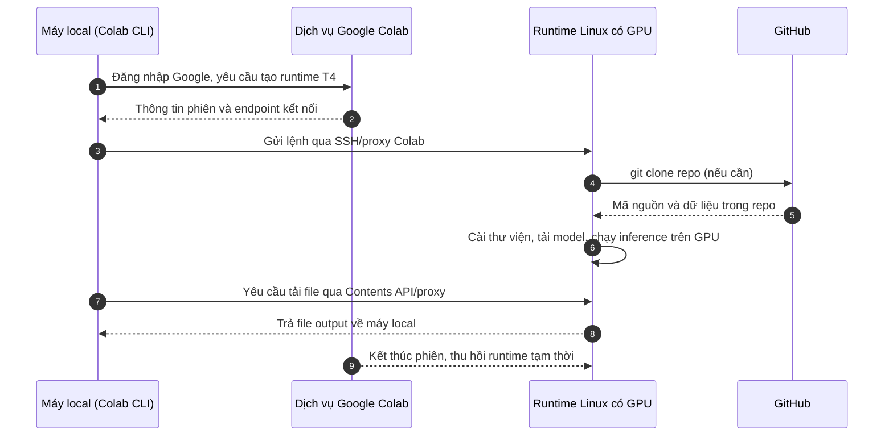

# Chạy model bằng Google Colab CLI

- **Mục đích:** dùng GPU Colab để chạy YOLO/SAM khi máy local yếu hoặc không có GPU.
- **Phân chia công việc:** model chạy trên Colab; CVAT, gán gold, review và QC làm trên máy local.
- **Nền tảng:** các lệnh dưới đây đã chạy trong PowerShell của dự án. [CLI chính thức](https://github.com/googlecolab/google-colab-cli) hiện liệt kê Linux/macOS là nền tảng được hỗ trợ; Windows có thể cần WSL.

## Colab CLI hoạt động như thế nào?

- **Colab CLI** chạy trên máy local, xác thực tài khoản Google và yêu cầu Colab cấp runtime.
- **Dịch vụ Colab** quản lý phiên, GPU và kết nối tới runtime; runtime là một máy Linux riêng, có filesystem riêng như `/content`.
- CLI gửi lệnh tới runtime qua kết nối SSH/proxy của Colab. `bash -lc` chạy lệnh bằng Bash trên máy Linux đó.
- Runtime tự clone repo từ GitHub, tải model và chạy inference. Việc clone repo không đồng nghĩa với việc Colab nhìn thấy các file đang có trên máy local.
- `colab-cli download` lấy file từ runtime về máy local qua giao diện file của runtime. File không tự đồng bộ; runtime và dữ liệu trong đó có thể bị xoá khi phiên kết thúc.
- Cách này dành GPU cho model, còn máy local giữ các công việc cần CVAT hoặc review trực tiếp.



## 1. Cài CLI và tạo runtime

- Cài CLI một lần trong môi trường Python local, khuyến nghị Python 3.12 trở lên:

```powershell
python -m pip install google-colab-cli
```

- CLI cần tài khoản Google để tạo/điều khiển runtime. Clone repo GitHub public bằng HTTPS không cần tài khoản GitHub.
- Ví dụ cấu hình phiên và tạo máy T4:

```powershell
# Tuỳ chọn: lưu cấu hình, phiên và log CLI trong thư mục riêng đã được Git bỏ qua.
$env:USERPROFILE = "$PWD\.colab-home"
$key = "C:\Users\<tên người dùng>\.ssh\id_ed25519"
```

```powershell
python -m colab_cli.cli new -s day08 --gpu T4
```

```powershell
python -m colab_cli.cli ssh -s day08 -i $key -- nvidia-smi -L
```


- `-s day08` đặt tên phiên; dùng lại tên này ở các lệnh sau.
- `--gpu T4` yêu cầu GPU T4; kết quả `nvidia-smi -L` xác nhận GPU đã sẵn sàng.
- `-i $key` chỉ định SSH key.
- Nếu gặp `HTTP 429` do một SSH khác còn mở, nhấn `Ctrl+C` ở kết nối đó rồi thử lại; không cần tạo runtime mới.

## 2. Clone repo, cài thư viện và tải model

```powershell
python -m colab_cli.cli ssh -s day08 -i $key -- bash -lc "git clone https://github.com/hoangnam312/K5-L23-Day08-AI-Assisted-Labeling /content/lab"
```

```powershell
python -m colab_cli.cli ssh -s day08 -i $key -- bash -lc "cd /content/lab && nvidia-smi -L && ls"
```

```powershell
python -m colab_cli.cli ssh -s day08 -i $key -- bash -lc "cd /content/lab && pip -q install 'ultralytics>=8.4.0' opencv-python-headless pyyaml matplotlib 'transformers>=5.0' huggingface_hub"
```

```powershell
python -m colab_cli.cli ssh -s day08 -i $key -- bash -lc "cd /content/lab && python scripts/download_models.py --set core"
```


- Thay URL repo và `/content/lab` khi dùng dự án khác. Dùng URL HTTPS bình thường, không thêm `\` trước dấu `:`.
- `bash -lc` chạy lệnh Linux trên runtime Colab; `cd /content/lab` chuyển vào repo trước khi gọi script.
- `pip install` cài thư viện trên Colab, không cài vào Python local.
- `--set core` tải các model YOLO26, YOLOE và SAM 2.1 của bài. Dòng `OK` cạnh tên model xác nhận tải thành công.
- Với dự án khác, thay lệnh cài thư viện và tải model theo repo đó.

## 3. Chạy pilot và kiểm tra kết quả

- Chạy thử trên tập `pilot` trước khi chạy toàn bộ:

```powershell
python -m colab_cli.cli ssh -s day08 -i $key -- bash -lc "cd /content/lab && python scripts/prelabel.py --model yolo26 --size m --split pilot --conf 0.25 --out work/prelabel/t_y26"
```

```powershell
python -m colab_cli.cli ssh -s day08 -i $key -- bash -lc "cd /content/lab && python scripts/prelabel.py --model yolo26 --size m --split pilot --conf 0.5 --out work/prelabel/t_y26_c05"
```

```powershell
python -m colab_cli.cli ssh -s day08 -i $key -- bash -lc "cd /content/lab && python scripts/prelabel.py --model yoloe --classes three_wheeler --split pilot --conf 0.25 --out work/prelabel/t_yoloe"
```

```powershell
python -m colab_cli.cli ssh -s day08 -i $key -- bash -lc "cd /content/lab && python scripts/prelabel.py --model yolo26 --size m --classes 'person,motorbike,car' --images img_004.jpg img_013.jpg --conf 0.3 --segmenter sam --sam sam2.1_b.pt --out work/prelabel/t_sam"
```


- `--split pilot` chọn tập thử; `--conf` đặt ngưỡng confidence; `--out` đặt thư mục lưu kết quả.
- `--segmenter sam --sam sam2.1_b.pt` bật SAM 2.1 để tạo mask.
- Kết thúc thành công sẽ báo số ảnh/box/mask và thư mục `viz/`.
- Xem ảnh `viz` để kiểm tra box/mask, nhãn sai và đối tượng bị bỏ sót; ghi nhận xét vào `submission/model_log.csv`.
- Cảnh báo lớp không có trong taxonomy nghĩa là dự đoán của lớp đó bị bỏ qua; đối chiếu ảnh gốc.
- YOLOE có thể tự cài CLIP và báo khởi động lại. Nếu đã in kết quả và không có lỗi cuối lệnh, lượt chạy đã hoàn tất.

**Chỉ chạy trên toàn bộ ảnh sau khi hoàn tất gán tay các ảnh gold:**

```powershell
python -m colab_cli.cli ssh -s day08 -i $key -- bash -lc "cd /content/lab && python scripts/prelabel.py --model yolo26 --size m --split all --conf 0.05 --out work/prelabel/y26_all --no-viz"
```

- Chạy thêm các model cần thiết theo notebook.
- Chọn ngưỡng dựa trên kết quả review pilot.

## 4. Tải kết quả về máy

- Runtime Colab là tạm thời; nén và tải output cần giữ về máy local:

```powershell
python -m colab_cli.cli ssh -s day08 -i $key -- bash -lc "cd /content/lab && zip -rq /content/lab/day08_pilot.zip work/prelabel/t_y26 work/prelabel/t_y26_c05 work/prelabel/t_yoloe work/prelabel/t_sam"
```

```powershell
python -m colab_cli.cli download -s day08 /content/lab/day08_pilot.zip .\day08_pilot.zip
```

```powershell
Expand-Archive .\day08_pilot.zip -DestinationPath . -Force
```


- Giải nén từ thư mục gốc repo để giữ cấu trúc `work/prelabel/...`.
- Mở `work/prelabel/*/viz/` để xem ảnh; dùng `pre.coco.json` làm pre-label để review/import theo [CVAT_AI.md](CVAT_AI.md).
- Không xem pre-label của ảnh gold trước khi hoàn tất gán tay.
- Không để output cần giữ lại chỉ trên runtime Colab.

## Dùng cho dự án khác

- Thay repo, dependencies, lệnh inference, model và đường dẫn dữ liệu/output. Giữ mô hình: clone → cài → tải model → pilot → review → batch → tải kết quả.
- Ví dụ dưới đây giả sử repo public, chạy PowerShell, có Python script inference và file requirements riêng cho Colab. Thay các giá trị mẫu theo dự án.

### Bước 1: Khai báo phiên và đường dẫn

```powershell
$session = "vision"
$key = "C:\Users\<tên người dùng>\.ssh\id_ed25519"
$repoUrl = "https://github.com/<owner>/<repo>"
$remoteDir = "/content/project"
```


- `$session` là tên runtime dùng lại trong mọi lệnh CLI.
- `$repoUrl` là địa chỉ clone; repo public dùng HTTPS, không cần đăng nhập GitHub.
- `$remoteDir` là thư mục dự án trên máy Colab, không phải đường dẫn trên Windows.

### Bước 2: Tạo runtime và kiểm tra GPU

```powershell
python -m colab_cli.cli new -s $session --gpu T4
```

```powershell
python -m colab_cli.cli ssh -s $session -i $key -- nvidia-smi -L
```


- Chọn GPU theo model và hạn mức tài khoản; T4 là ví dụ.
- Chỉ tiếp tục khi lệnh kiểm tra hiện GPU mong muốn.

### Bước 3: Đưa mã nguồn lên runtime

```powershell
python -m colab_cli.cli ssh -s $session -i $key -- bash -lc "git clone $repoUrl $remoteDir"
```

```powershell
python -m colab_cli.cli ssh -s $session -i $key -- bash -lc "cd $remoteDir && ls"
```


- Nếu repo riêng tư, cần cấu hình quyền GitHub riêng; không dán token vào lệnh hoặc log.
- Nếu dữ liệu không nằm trong repo, cần upload/mount theo quy định dữ liệu của dự án.

### Bước 4: Cài dependencies và tải trọng số

```powershell
python -m colab_cli.cli ssh -s $session -i $key -- bash -lc "cd $remoteDir && pip install -r requirements-colab.txt"
```

```powershell
python -m colab_cli.cli ssh -s $session -i $key -- bash -lc "cd $remoteDir && python scripts/download_models.py --set <model-set>"
```


- Dùng requirements dành cho Colab nếu có; tránh cài lại PyTorch/CUDA không tương thích.
- Thay script và `<model-set>` theo cách dự án quản lý model. Nếu model được tải trực tiếp trong inference, bỏ lệnh tải riêng.

### Bước 5: Chạy thử một phần nhỏ

```powershell
python -m colab_cli.cli ssh -s $session -i $key -- bash -lc "cd $remoteDir && python scripts/infer.py --input data/pilot --output outputs/pilot"
```

- Thay `scripts/infer.py`, input và output bằng CLI thực tế của dự án.
- Kiểm tra log, nhãn và ảnh xem trước trước khi chạy toàn bộ dữ liệu.

### Bước 6: Chạy batch và đóng gói kết quả

```powershell
python -m colab_cli.cli ssh -s $session -i $key -- bash -lc "cd $remoteDir && python scripts/infer.py --input data/all --output outputs/all"
```

```powershell
python -m colab_cli.cli ssh -s $session -i $key -- bash -lc "cd $remoteDir && zip -rq /content/project/outputs.zip outputs"
```

```powershell
python -m colab_cli.cli download -s $session /content/project/outputs.zip .\outputs.zip
```


- Đổi `data/all`, `outputs/all` và đường dẫn ZIP theo cấu trúc dự án.
- Chỉ chạy batch sau khi pilot đạt yêu cầu; luôn tải ZIP về local trước khi kết thúc runtime.

### Bước 7: Giải nén và review tại local

```powershell
Expand-Archive .\outputs.zip -DestinationPath . -Force
```

- Giải nén vào repo local để giữ cấu trúc output.
- Kiểm tra kết quả rồi mới import vào CVAT hoặc dùng cho bước tiếp theo.
- Chỉ dừng runtime sau khi đã tải đủ file cần giữ.
